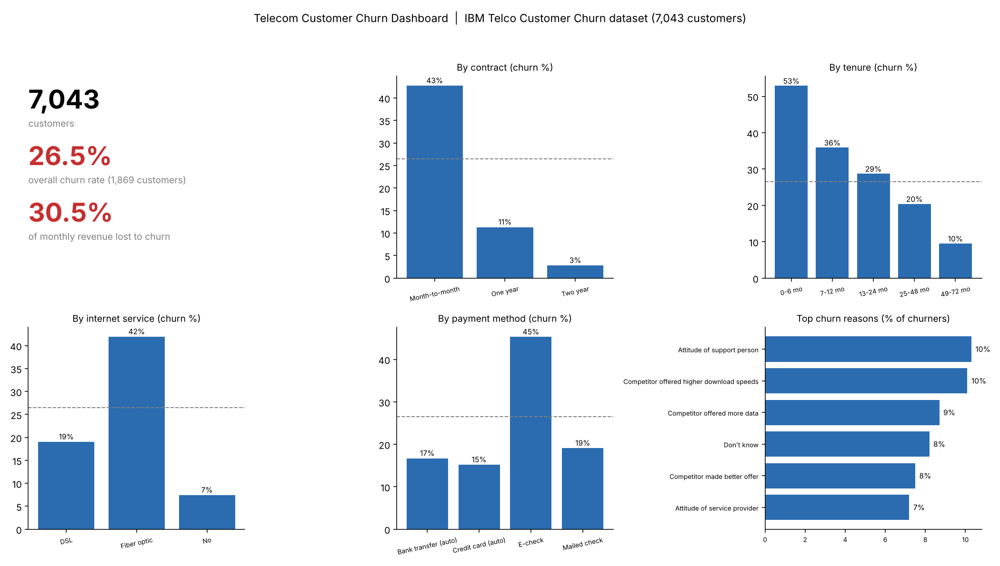
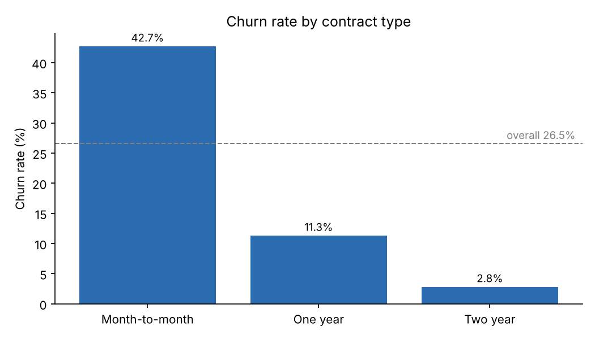
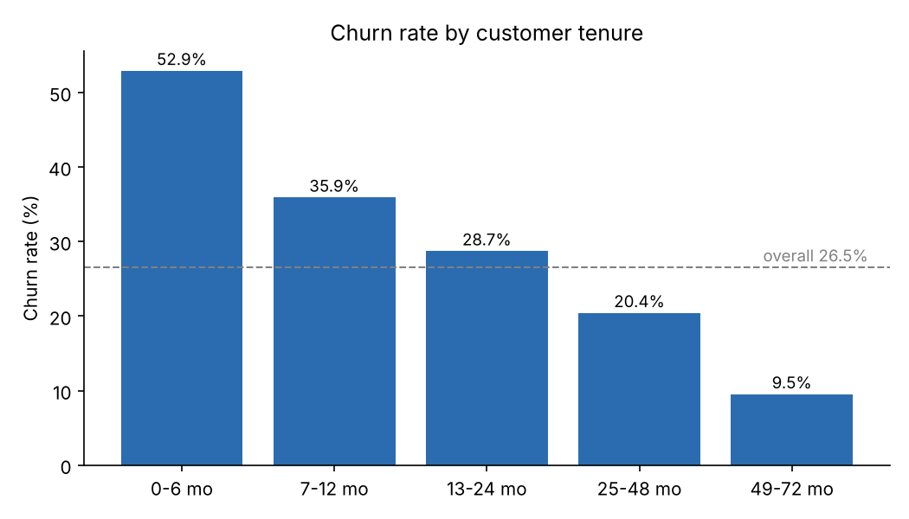
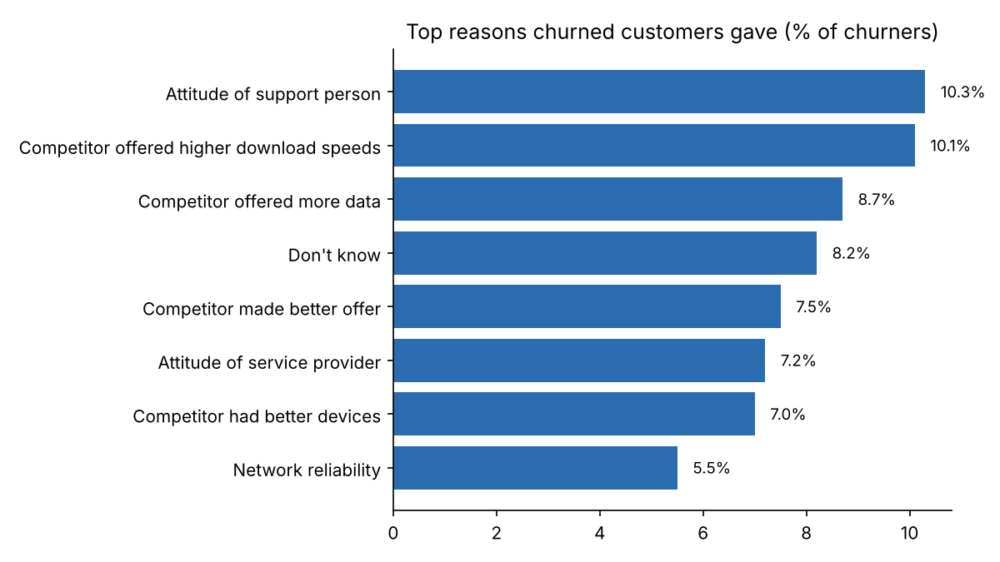
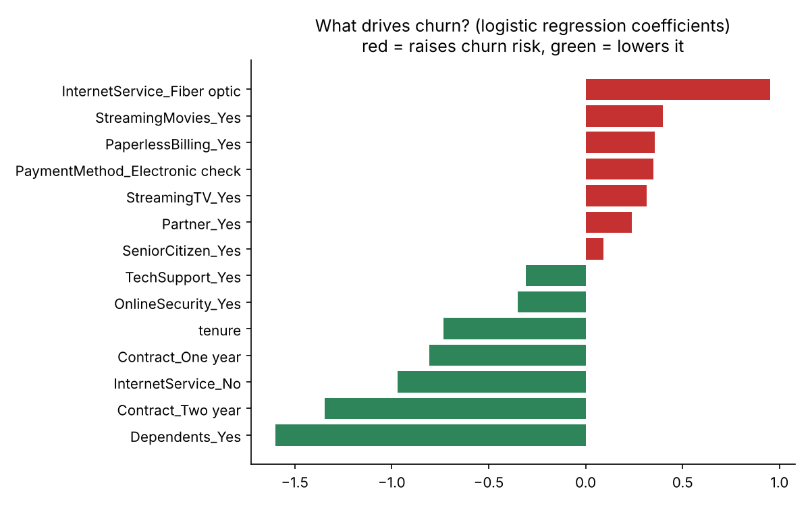

# Telecom Customer Churn Analysis

**Which customers leave a telecom provider, when do they leave, and what should the company do about it?**

An end-to-end analysis of 7,043 telecom customers using **SQL and Python (Pandas, scikit-learn, Matplotlib)**. It covers data cleaning, segment analysis, a churn-driver model, and concrete retention recommendations.



## Business problem

Winning a new subscriber costs far more than keeping an existing one. This project finds which customer segments churn most, how much monthly revenue that puts at risk, and where a retention team should focus first.

## Dataset

IBM Telco Customer Churn sample dataset (Kaggle): **7,043 customers**, 33 columns covering location (California), demographics, services, contract, billing, churn status, churn score, customer lifetime value (CLTV) and the stated reason for leaving.

## Key findings

**Overall:** 1,869 of 7,043 customers churned (**26.5%**). Their monthly charges add up to **$139,131, or 30.5% of all monthly charges**.

**1. Contract type is the biggest dividing line.**
Month-to-month customers churn at **42.7%**, versus **11.3%** on one-year and **2.8%** on two-year contracts. Month-to-month customers are 55% of the base but **88.6% of all churners**.



**2. Customers leave early.**
Churn is **52.9%** in the first 6 months and falls to **9.5%** for customers with 4+ years of tenure. **55.5% of all churners left within their first 12 months.**



**3. Fibre optic customers churn far more than DSL.**
Fibre churns at **41.9%** versus **19.0%** for DSL and **7.4%** for customers with no internet service. Fibre customers also pay more (average monthly charge $91.50 versus $58.10 for DSL).

**4. Electronic-check payers are the highest-risk payment group.**
**45.3%** churn, versus **15.2%** for credit-card autopay and **16.7%** for bank-transfer autopay. The gap holds within month-to-month customers (53.7% for e-check versus 31.6% to 34.1% for the other methods).

**5. Tech support and online security go with much lower churn.**
Among internet customers, those with tech support churn at **15.2%** versus **41.6%** without. Churn falls steadily as customers hold more add-on services: **56.7%** with none, **5.3%** with all four.

**6. Other patterns.**
Senior citizens churn at **41.7%** (versus 23.6%); customers without dependents at **32.6%** (versus 6.5% with dependents); paperless-billing customers at **33.6%** (versus 16.3%).

**7. A small high-risk segment drives a large share of losses.**
Month-to-month, fibre optic, no tech support, tenure of 12 months or less: **833 customers (11.8% of the base)**, **71.1% churn**. This segment accounts for **31.7% of all churners** and **34.9% of the lost monthly revenue ($48,490)**.

**8. Churned customers pay more and stay for less time.**
Average monthly charge **$74.44** (churned) versus **$61.27** (retained); average tenure **18.0** versus **37.6** months.

### Why customers say they left

Churn reasons are recorded only for customers who left. **33.3%** cite a competitor (higher download speeds, more data, a better offer, better devices), and **17.5%** cite the attitude of support staff or the service provider. The single most common reasons are *attitude of support person* (10.3%) and *competitor offered higher download speeds* (10.1%). Network reliability (5.5%) and price (5.2%) are smaller but real. 8.2% answered "don't know".



### Churn-driver model

A logistic regression (class-balanced, 75/25 train/test split) was used to see which factors matter when the others are held constant. It reached **ROC-AUC 0.85**, catching **79% of churners** on the test set at the default threshold (precision 53%, the expected trade-off when favouring recall).

- Factors that raise churn risk most: **fibre optic service**, streaming movies, **paperless billing**, **electronic-check payment**, streaming TV.
- Factors that lower it most: **having dependents**, **two-year contract**, **no internet service**, **one-year contract**, **longer tenure**.

Churn Score, CLTV and Churn Reason were deliberately left out of the model: Churn Score is itself a prediction and Churn Reason only exists for churners, so using them would leak the answer.



## Recommendations

1. **Start with the high-risk segment.** Month-to-month fibre customers without tech support in their first year are 11.8% of customers but about a third of churn and lost revenue. A targeted offer here has the biggest payoff per customer contacted.
2. **Fix the first 90 days.** More than half of churners leave within a year, and 52.9% of customers in months 0 to 6 churn. Add a proactive onboarding programme: setup help, a check-in call, and a speed or service check shortly after install.
3. **Move month-to-month customers onto longer contracts.** Month-to-month accounts for 88.6% of churn. Offer a price lock or a free add-on in exchange for a 12-month term, and A/B test it, since customers who pick longer contracts may already be more loyal.
4. **Review the fibre offering against competitors.** Fibre churns at more than double the DSL rate, and a third of churners name competitor speed, data or offers. Check fibre pricing and performance against local rivals and look into network reliability complaints.
5. **Bundle tech support and online security for at-risk internet customers.** Customers with these services churn far less. Trial them free for the first months and measure whether churn falls.
6. **Push electronic-check payers towards autopay.** Their churn is nearly three times that of autopay customers. A small autopay discount is cheap to test.
7. **Invest in support quality.** 17.5% of churners blame staff or provider attitude, which is fixable through training and call-quality monitoring.

## Limitations

- This is a **single snapshot**, so the results show association, not proven cause. Customers on long contracts may simply be more loyal to begin with.
- The data is a public IBM **sample dataset** (California only), not live operator data, so figures will not match a real provider.
- Churn reasons exist only for churned customers, and are self-reported.
- The model was built for interpretability, not tuned for maximum accuracy; no threshold optimisation or cross-validation was done.

## SQL analysis

`sql/churn_queries.sql` contains the table definition and 13 analysis queries written in MySQL syntax: churn by contract, tenure, payment method and service, contract-by-tenure segments, the high-risk segment, add-on analysis, churn reasons, customer value and cities. An optional MySQL 8 section adds window-function versions. The output of every query is recorded in [`sql/query_results.md`](sql/query_results.md).

## How to reproduce

```bash
pip install -r requirements.txt
# put Telco_customer_churn.xlsx (Kaggle: Telco Customer Churn IBM dataset) in data/
python churn_analysis.py
```

This cleans the data, saves `data/telco_clean.csv`, and regenerates every chart and number in `outputs/`. To use SQL, create the table from `sql/churn_queries.sql`, import `data/telco_clean.csv`, and run the queries.

## Repository structure

```
├── churn_analysis.py        cleaning, charts, model, dashboard image
├── requirements.txt
├── data/
│   └── telco_clean.csv      cleaned data (raw Kaggle file not included)
├── sql/
│   ├── churn_queries.sql    table + 13 analysis queries
│   └── query_results.md     recorded output of every query
└── outputs/                 charts, dashboard image, findings
```

## Data cleaning notes

- `Total Charges` was stored as text; 11 blanks (customers with 0 months of tenure, not yet billed) were set to 0.
- "No internet service" and "No phone service" were merged into "No" for add-on columns.
- Added `TenureBand`, `ChurnFlag` and `ProtectionServices` (count of the four protection add-ons) columns.
